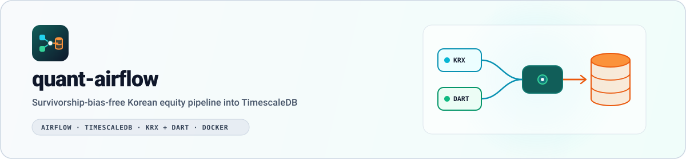
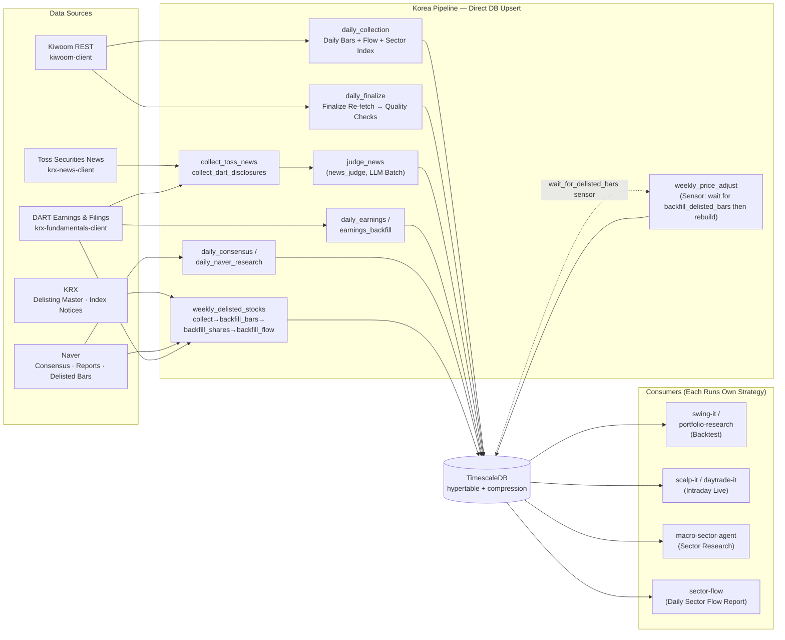
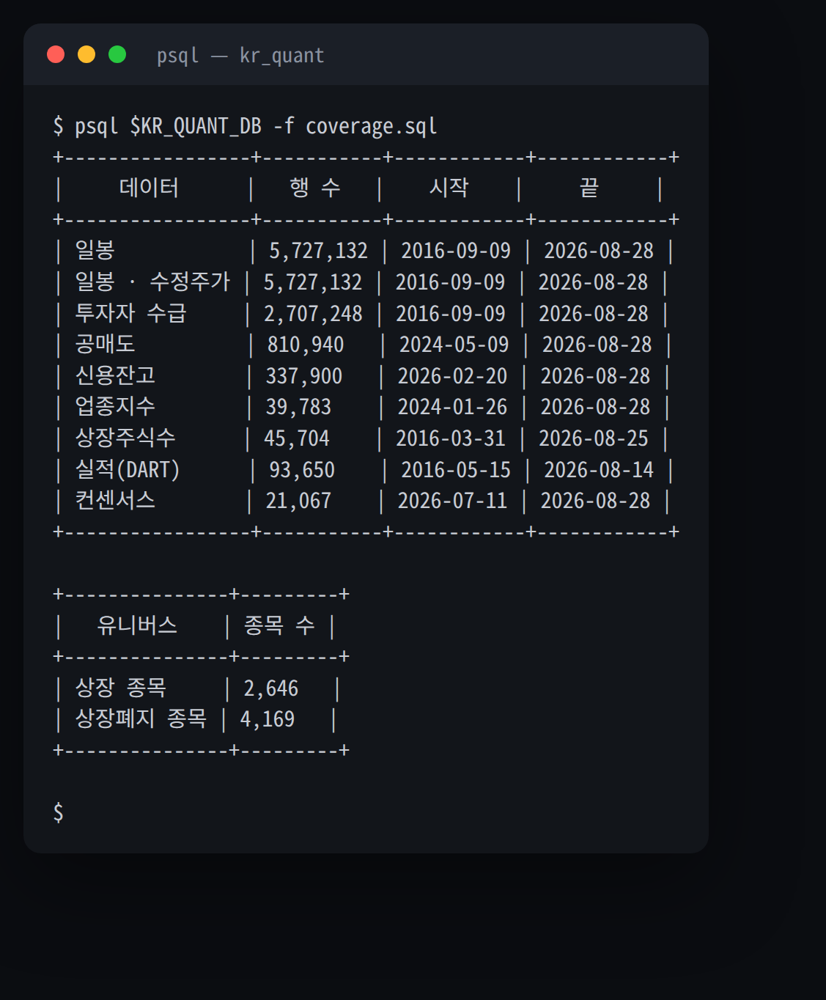

<picture>
  <source media="(prefers-color-scheme: dark)" srcset="docs/images/brand/banner-dark.svg">
  
</picture>

[한국어](README.md) | **English**

**An Airflow pipeline that ingests Korean equity data into TimescaleDB — restoring delisted stocks so backtests run on top of it stay free of survivorship bias.**

[](https://github.com/younghwan91/quant-airflow/actions/workflows/ci.yml)
[](LICENSE)
[](https://www.linkedin.com/in/younghwan-chae/)

- **31% of all stocks ever traded are already delisted.** Collecting only currently listed tickers erases 37% of the 2008 universe. This pipeline restores them in order: KRX delisting master → Naver historical daily bars → DART shares outstanding. (Source: `daily_bars_adj_v2` × `stocks` / `delisted_stocks` ∪ `kind_delistings`, [`docs/images/hero-data.csv`](docs/images/hero-data.csv))
- **Values fetched at 16:00 KST are provisional.** Early the next morning, `daily_finalize` re-fetches and overwrites the previous trading day's daily bars and investor flow with finalized values, then rebuilds adjusted prices.
- **LLM news judgments are only written to a table — this repo never places orders.** It only collects and loads data; strategies, backtesting, and execution belong to downstream repos that read this DB.

## Quick start

```bash
git clone https://github.com/younghwan91/quant-airflow.git
git clone https://github.com/younghwan91/swing-it.git ../swing-it                       # sibling — mounted read-only by compose
git clone https://github.com/younghwan91/portfolio-research.git ../portfolio-research  # sibling
cd quant-airflow
cp .env.example .env   # Fill required values below — add TIMESCALE_HOST & KR_QUANT_DB manually (not in example), set TIMESCALE_PORT to 5433

docker compose -f docker-compose.replica.yml up -d   # DB (PRIMARY) — volume is external
docker compose -f docker-compose.airflow.yml up -d   # Airflow
```

Any Postgres client can read the stored data.

```python
import os
import pandas as pd, psycopg2
conn = psycopg2.connect(host=os.environ["TIMESCALE_HOST"], port=5433, dbname="kr_quant",
                        user=os.environ["TIMESCALE_USER"], password=os.environ["TIMESCALE_PASSWORD"])
df = pd.read_sql("SELECT * FROM daily_bars_adjusted WHERE code = %s ORDER BY date",
                 conn, params=("005930",))
```

The DB command above starts **a volume that already contains data**. When setting up a fresh machine from scratch, see [Configuration & Operations](#configuration--operations).

<picture>
  <source media="(prefers-color-scheme: dark)" srcset="docs/images/hero-dark.png">
  
</picture>

## What It Collects

22 Airflow (LocalExecutor) DAGs, 20 of which run on schedule. Every collector performs a `(code, date)` upsert—making re-runs idempotent—and tags each row with `source` (`kiwoom`/`naver`/`krx`/`dart`).

| Domain | Source | Tables | DAG |
|---|---|---|---|
| Daily bars · Investor flow · Sector index | Kiwoom REST | `daily_bars` · `supply_demand` · `sector_index` | `daily_collection` Weekdays 16:00 → `daily_finalize` Tue–Sat 06:30 finalize |
| Unadjusted daily bars | Kiwoom REST | `daily_bars_raw` | `daily_bars_raw` Weekdays 19:00 |
| Adjusted prices | (Rebuilt in-DB) | `daily_bars_adjusted` | `daily_price_adjust` Weekdays 16:55 · `weekly_price_adjust` Sat 10:40 |
| Short selling · Margin credit balance | Kiwoom REST | `short_selling` · `credit_balance` | `daily_short_credit` Tue–Sat 10:00 |
| Earnings (point-in-time) | DART | `earnings` | `daily_earnings` Weekdays 16:00 · `earnings_backfill` Sun 10:00 |
| Shares outstanding (point-in-time) | Kiwoom · DART | `shares_outstanding_history` · `shares_original_filing` (first filing date & value) | `weekly_listed_shares` Tue 10:10 · `monthly_listed_shares_backfill` 1st of month |
| WICS sector & industry weekly snapshot | wiseindex | `wics_membership` | `weekly_wics` Tue 18:25 |
| Delisted stock restoration | KRX · Naver · DART | `delisted_stocks` · `daily_bars` (`source='naver'`) | `weekly_delisted_stocks` Sat 10:05 |
| Consensus · Broker research reports | Naver | `consensus` · `naver_research_reports` | `daily_consensus` Weekdays 17:00 · `daily_naver_research` Daily 05:40 |
| News & disclosures + LLM judgment | Toss Securities · DART | `news_articles` · `news_company_feed` · `news_judgments` | `premarket_news_judgment` Weekdays 08:45 · `daily_news` 10:05/16:05 · `daily_toss_company_news` 17:10 |
| Index inclusion/exclusion notices | KRX | `index_notices` · `index_changes` · `index_constituents` | `daily_index_notices` Weekdays 18:30 |
| History depth maintenance | Kiwoom | Sector index · Short selling · Credit | `weekly_history_backfill` Sun 11:00 |
| Previous-day failure catch-up | Kiwoom | — | `daily_collection_catchup` Weekdays 10:05 |

Two disabled DAGs: `daily_sharadar` (US equities, see below) and `daily_krx_shares` (manual-only because the KRX source is behind a login wall). All times are KST. API calls and parsing live in [kiwoom-client](https://github.com/younghwan91/kiwoom-client), [krx-fundamentals-client](https://github.com/younghwan91/krx-fundamentals-client), and [krx-news-client](https://github.com/younghwan91/krx-news-client); `collectors/` in this repo only assembles and loads. `earnings_disclosures` (filing receipt dates) and `shares_original_filing` do not yet have scheduled DAGs and are populated manually.

**US equities (Sharadar) are paused.** Following subscription cancellation on 2026-09-14, `daily_sharadar` has `schedule=None` and the DuckDB store remains frozen at the 09-11 build. The bulk snapshot → rebuild → validate → `os.replace` publish design is preserved in [`docs/sharadar.md`](docs/sharadar.md).

## Why It's Built This Way

**Fix survivorship bias at ingestion time.** Most collectors iterate over "currently listed stocks," so backtests built on top only measure survivors. Here, delisted equities are restored in three layers:

| Layer | What | Where |
|---|---|---|
| Master | Delisted stock list | KRX → `delisted_stocks` |
| Prices | Historical daily bars before delisting | Naver → `daily_bars` (`source='naver'`). Pre-2016-09 delistings are in `daily_bars_delisted_naver` (KIND ∪ KRX list, migration 028, one-off manual load) |
| Shares | Market cap denominator (point-in-time) | DART → `shares_outstanding_history` |

**NULL ≠ 0.** NULL means unknown; 0 means zero. Naver delisted bars have approximate trading value and only institutional/foreign investor flow—fields not provided by the source are kept as NULL, and erroneous source values are moved to the `legacy` schema rather than silently "fixed." Consumers must distinguish the two to prevent universes from silently shifting across metrics.

**Point-in-time.** `earnings` and `shares_outstanding_history` accumulate restatement histories keyed by `knowledge_date` instead of overwriting. Copying today's values into the past leaks future information into historical backtests.

**Distinguish provisional vs. finalized values.** Post-close values are overwritten by finalized data early the next morning, and `collectors/data_checks.py` runs after `daily_finalize` to check minute-bar session ranges, close-price identities, raw-price canaries, adjusted-price seams (vs. raw prices), shares-outstanding canaries, and missingness rates daily. After the KRX aftermarket launched on 2026-09-14, daily high/low/close/volume switched to combined-session values and went unnoticed for nearly a month—which is why these checks exist.

**"Green light ≠ success."** Collectors returning empty responses as success caused recurring incidents. New collectors raise on empty responses, and daily `rows=0` is treated as an outage. Because 0 runs are not caught as failures, `scripts/daily_health_check.sh` separately checks the latest date of core tables and the freshness of the `swing-it` forward paper-trading ledger at 11:35 and 18:10.

**Batch LLM judgments, table outputs.** News and disclosure judgments run via the Batch API, recording batch IDs in `news_judge_batches` first. Judgments are simply stored in `news_judgments`—how to use them is up to downstream repos.

## Architecture

Because Korean source APIs only provide incremental data, pipelines upsert directly into the DB. The diagram below reflects the actual task dependencies (`>>`) in `dags/*.py`.



## Configuration & Operations

Airflow (scheduler, webserver, metadata DB) and TimescaleDB run 24/7 **on the same host (simnode) as separate compose stacks**—restarting one does not disturb the other.

| Compose file | Contents |
|---|---|
| `docker-compose.replica.yml` | TimescaleDB **PRIMARY** (`:5433`). Named `replica` only for historical reasons—its role was promoted via `pg_promote()`, and the volume/port names are hardcoded across DSNs. Verify role with `SELECT pg_is_in_recovery();` (`false` = PRIMARY). |
| `docker-compose.airflow.yml` | 4 Airflow services. No DB in this file—connects to the PRIMARY above via `TIMESCALE_HOST`/`TIMESCALE_PORT` in `.env`. |
| `docker-compose.timescale.yml` | Initial DB setup (`initdb`) reference. |

`docker-compose.replica.yml` uses an `external` volume and lacks `POSTGRES_USER/PASSWORD/DB`, so it cannot initialize an empty volume. When provisioning a new machine, refer to `docker-compose.timescale.yml` (which includes those env vars and the `sql/init_timescale.sql` mount) or restore from the Google Drive backup. Canonical schema lives in `sql/init_timescale.sql` + `sql/migrations/*.sql`.

**There is only one live DB copy**—no streaming replica; the second copy is the Google Drive backup (`scripts/backup_to_gdrive.sh`).

Values to configure in `.env`:

| Variable | Purpose |
|---|---|
| `KIWOOM_APP_KEY` / `KIWOOM_APP_SECRET` | Kiwoom REST — prices, flow, short selling, credit, shares outstanding |
| `DART_API_KEY`(`_2`/`_3`) | DART OpenAPI — [free registration](https://opendart.fss.or.kr); adding secondary keys scales the daily quota linearly |
| `ANTHROPIC_API_KEY` | News & disclosure LLM judgment (Batch API) |
| `TIMESCALE_*` / `AIRFLOW_*` | DB credentials & Airflow secrets (generation instructions in `.env.example`). **Manually add `TIMESCALE_HOST` (host LAN IP) and `KR_QUANT_DB` (DSN) which are absent from `.env.example`, and change `TIMESCALE_PORT` from 5432 to 5433** |
| `ALERT_WEBHOOK_URL` | Optional. If unset, alerts are only written to `alerts.log` |
| `US_DATA_DIR` | Sharadar DuckDB store directory. Without it, `daily_sharadar` will not run |

TimescaleDB is exposed on the LAN so other machines can run read-only queries. Sibling repos on the same host (`scalp-it`, `daytrade-it` crons) also read their DSN from this `.env`—do not rename or delete keys.



*Coverage snapshot as of 2026-08-28. Query in [`docs/coverage.sql`](docs/coverage.sql).*

## Further Reading

- [`docs/schema.md`](docs/schema.md) — Tables, PKs, units, compression design, migrations
- [`docs/operations.md`](docs/operations.md) — 24/7 single host, deployment paths, alerting, backups
- [`docs/sharadar.md`](docs/sharadar.md) — US pipeline (paused)

Licensed under [MIT](LICENSE).

## Contributing & Issues

- 🐛 Bug reports, questions, pipeline suggestions: [GitHub Issues](https://github.com/younghwan91/quant-airflow/issues)
- 📈 Updates: [Follow @younghwan91](https://github.com/younghwan91)

## Author

**Younghwan Chae (채영환)** · [GitHub @younghwan91](https://github.com/younghwan91) · [LinkedIn](https://www.linkedin.com/in/younghwan-chae/)
