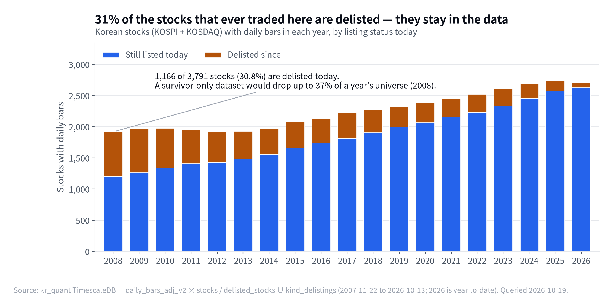

<div align="center">

<picture>
  <source media="(prefers-color-scheme: dark)" srcset="docs/images/brand/wordmark-dark.svg">
  
</picture>

# quant-airflow

**An Airflow pipeline that ingests Korean equity data into TimescaleDB, including restored delisted stocks.**

It collects prices, investor flow, earnings, shares outstanding, and LLM news judgments point-in-time to prevent survivorship bias at the storage layer.

[](https://github.com/younghwan91/quant-airflow/actions/workflows/ci.yml)
[](LICENSE)
[](https://www.linkedin.com/in/younghwan-chae/)

[Guide](docs/guide.en.md) · [Try it](#try-it-no-keys-no-db) · [Quick start](#quick-start) · [Schema](docs/schema.md) · [Operations](docs/operations.md) · [한국어](README.md)

</div>

<picture>
  <source media="(prefers-color-scheme: dark)" srcset="docs/images/hero-dark.png">
  
</picture>

<p align="center"><sub>31% of all stocks ever traded are already delisted. Both listed and delisted histories are preserved so 37% of the 2008 universe is not lost (<a href="docs/images/hero-data.csv">data</a>).</sub></p>

## Try it (no keys, no DB)

```bash
git clone https://github.com/younghwan91/quant-airflow.git && cd quant-airflow
python scripts/demo_survivorship.py
```

```text
[synthetic data] equal-weight buy & hold from 2018-01-02
  4 currently listed stocks only : +110.0%
  7 stocks incl. 3 delisted      : +22.6%
  survivorship bias              : +87.4%p overstated
```

The data is synthetic (not real tickers) and the bias is exaggerated for illustration. It runs on this pipeline's `stocks`/`delisted_stocks` schema and shows how much a universe without delisted names inflates returns. See the chart above for real-data scale.

## Quick start

```bash
git clone https://github.com/younghwan91/quant-airflow.git
git clone https://github.com/younghwan91/swing-it.git ../swing-it                       # mounted read-only by compose
git clone https://github.com/younghwan91/portfolio-research.git ../portfolio-research  # sibling repo
cd quant-airflow
cp .env.example .env   # Add TIMESCALE_HOST & KR_QUANT_DB, set TIMESCALE_PORT=5433

docker compose -f docker-compose.replica.yml up -d   # TimescaleDB (PRIMARY, external volume)
docker compose -f docker-compose.airflow.yml up -d   # Airflow scheduler & webserver
```

Any Postgres client can query the stored data.

```python
import os
import pandas as pd, psycopg2

conn = psycopg2.connect(
    host=os.environ["TIMESCALE_HOST"], port=5433, dbname="kr_quant",
    user=os.environ["TIMESCALE_USER"], password=os.environ["TIMESCALE_PASSWORD"],
)
df = pd.read_sql(
    "SELECT * FROM daily_bars_adjusted WHERE code = %s ORDER BY date",
    conn, params=("005930",),
)
```

The DB command above starts a volume that already contains data. When provisioning a fresh machine from scratch, see the [Configuration & Operations Guide](docs/guide.en.md#configuration--operations).

## What It Collects

22 Airflow (LocalExecutor) DAGs, 20 of which run on schedule. Every collector performs an idempotent `(code, date)` upsert and tags each row with `source` (`kiwoom`/`naver`/`krx`/`dart`).

- **Daily bars, flow & sector index**: Fetches provisional values from Kiwoom REST after market close; `daily_finalize` overwrites them with finalized data early the next morning.
- **Delisted stock restoration**: Restores KRX delisting masters, Naver historical daily bars, and DART shares outstanding across three layers to prevent survivorship bias.
- **Earnings & shares outstanding (point-in-time)**: Accumulates DART restatement histories keyed by `knowledge_date` so historical queries never leak future data.
- **Short selling, credit, consensus & index notices**: Collects daily and weekly market metrics from Kiwoom, Naver, wiseindex, and KRX.
- **News & disclosure LLM judgments**: Evaluates Toss Securities news and DART disclosures via the Batch API and writes results to `news_judgments`.

See the [full DAG schedule and table list](docs/guide.en.md#what-it-collects) in the guide.

## Caveats

- **Provisional vs. finalized values**: Values fetched at 16:00 KST are provisional. Early the next morning, `daily_finalize` overwrites them with finalized data and rebuilds adjusted prices.
- **NULL ≠ 0**: Fields omitted by a source (such as individual investor flow on Naver delisted bars) are kept as `NULL`, not `0`.
- **No order execution**: This repository only collects and loads raw data. Strategies and execution live in separate downstream repositories.
- **US equities (Sharadar) paused**: `daily_sharadar` is disabled following subscription cancellation ([details](docs/sharadar.md)).

See [Why It's Built This Way](docs/guide.en.md#why-its-built-this-way) for design principles, architecture diagrams, and daily data quality checks.

## Docs

| Doc | Contents |
|---|---|
| [`docs/guide.en.md`](docs/guide.en.md) | Full DAG schedule, design principles, architecture diagram, `.env` configuration |
| [`docs/schema.md`](docs/schema.md) | Tables, PKs, units, compression design, migrations |
| [`docs/operations.md`](docs/operations.md) | 24/7 single host, deployment paths, alerting, backups |
| [`docs/sharadar.md`](docs/sharadar.md) | US (Sharadar) pipeline design (paused) |

## Contributing & Issues

- Report bugs or suggest pipeline improvements in [GitHub Issues](https://github.com/younghwan91/quant-airflow/issues).
- Author: **Younghwan Chae (채영환)** · [GitHub @younghwan91](https://github.com/younghwan91) · [LinkedIn](https://www.linkedin.com/in/younghwan-chae/)

## Tools by the same author

- [kiwoom-client](https://github.com/younghwan91/kiwoom-client): the Kiwoom REST client this pipeline pulls prices with.
- [fin-checkup](https://github.com/younghwan91/fin-checkup): traffic-light financial checkups for listed companies from DART filings.
- [krx-quant-core](https://github.com/younghwan91/krx-quant-core): shared core for Korean-equity quant systems: market rules, costs, order guards, validation stats.
- [swing-it](https://github.com/younghwan91/swing-it): a statistical framework that tests alpha hypotheses against random versions of themselves.

## License

[MIT](LICENSE)
