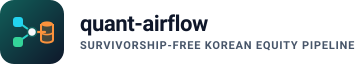
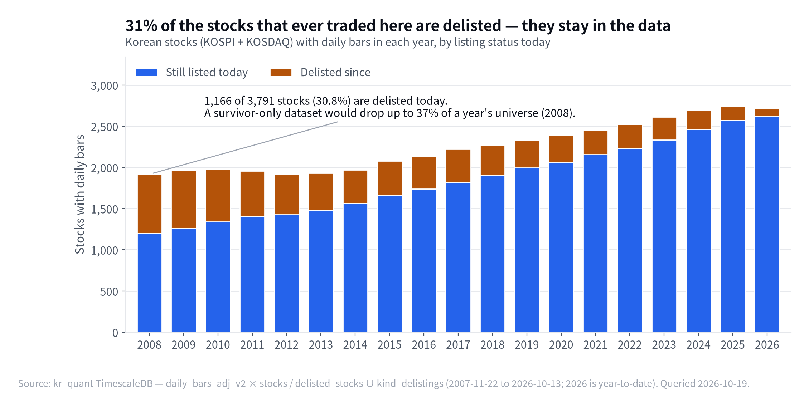

<div align="center">

<picture>
  <source media="(prefers-color-scheme: dark)" srcset="docs/images/brand/wordmark-dark.svg">
  
</picture>

# quant-airflow

**상장폐지 종목까지 되살려 TimescaleDB에 적재하는 한국 주식 Airflow 파이프라인입니다.**

시세·수급·실적·주식수·뉴스 판정을 point-in-time으로 모아 백테스트의 생존편향을 저장 층에서 막습니다.

[](https://github.com/younghwan91/quant-airflow/actions/workflows/ci.yml)
[](LICENSE)
[](https://www.linkedin.com/in/younghwan-chae/)

[가이드](docs/guide.md) · [Quick start](#quick-start) · [스키마](docs/schema.md) · [운영](docs/operations.md) · [English](README.en.md)

</div>

<picture>
  <source media="(prefers-color-scheme: dark)" srcset="docs/images/hero-dark.png">
  
</picture>

<p align="center"><sub>거래된 적 있는 종목의 31%는 이미 상장폐지됐습니다. 2008년 유니버스의 37%가 빠지지 않도록 상장·폐지 이력을 함께 보관합니다 (<a href="docs/images/hero-data.csv">데이터</a>).</sub></p>

## Quick start

```bash
git clone https://github.com/younghwan91/quant-airflow.git
git clone https://github.com/younghwan91/swing-it.git ../swing-it                       # compose가 읽기 전용으로 마운트합니다
git clone https://github.com/younghwan91/portfolio-research.git ../portfolio-research  # sibling 저장소
cd quant-airflow
cp .env.example .env   # TIMESCALE_HOST·KR_QUANT_DB 추가, TIMESCALE_PORT=5433 설정

docker compose -f docker-compose.replica.yml up -d   # TimescaleDB (PRIMARY, external 볼륨)
docker compose -f docker-compose.airflow.yml up -d   # Airflow 스케줄러·웹서버
```

적재된 데이터는 Postgres 클라이언트로 바로 조회할 수 있습니다.

```python
import os
import pandas as pd, psycopg2

conn = psycopg2.connect(
    host=os.environ["TIMESCALE_HOST"], port=5433, dbname="kr_quant",
    user=os.environ["TIMESCALE_USER"], password=os.environ["TIMESCALE_PASSWORD"],
)
df = pd.read_sql(
    "SELECT * FROM daily_bars_adjusted WHERE code = %s ORDER BY date",
    conn, params=("005930",),
)
```

위 DB 명령은 이미 데이터가 들어 있는 볼륨을 띄우는 방식입니다. 새 머신에 처음 구축할 때는 [설정·운영 가이드](docs/guide.md#설정운영)를 참고하시기 바랍니다.

## 무엇을 수집하나

Airflow(LocalExecutor) DAG 22개 가운데 20개가 스케줄로 동작합니다. 모든 수집기는 `(code, date)` 기준 멱등 upsert로 동작하며 행마다 `source`(`kiwoom`/`naver`/`krx`/`dart`)를 기록합니다.

- **일봉·수급·업종지수**: 키움 REST에서 장 마감 후 잠정치를 받고, 다음 날 새벽 `daily_finalize`가 확정치로 덮습니다.
- **상장폐지 종목 복원**: KRX 폐지 마스터, 네이버 과거 일봉, DART 상장주식수를 3층으로 복원해 생존편향을 막습니다.
- **실적·상장주식수 (point-in-time)**: DART 공시 정정 이력을 `knowledge_date` 기준으로 쌓아 과거 조회 시 미래 참조를 막습니다.
- **공매도·신용·컨센서스·지수 공지**: 키움, 네이버, wiseindex, KRX에서 일별·주별 시장 지표를 수집합니다.
- **뉴스·공시 LLM 판정**: 토스증권 뉴스와 DART 공시를 Batch API로 판정해 `news_judgments` 테이블에 기록합니다.

전체 DAG 일정과 테이블 목록은 [가이드의 수집 목록](docs/guide.md#무엇을-수집하나)에서 확인할 수 있습니다.

## 읽을 때 주의할 점

- **잠정치와 확정치**: 평일 16:00 수집값은 잠정치입니다. 다음 날 새벽 `daily_finalize`가 확정치로 덮어쓰고 조정주가를 다시 계산합니다.
- **NULL ≠ 0**: 원천이 제공하지 않는 값(예: 네이버 폐지 종목 수급의 개인 항목)은 `0`이 아니라 `NULL`로 남깁니다.
- **주문 미실행**: 이 저장소는 원본 데이터 수집·적재만 담당합니다. 전략과 매매 실행은 이 DB를 읽는 별도 저장소에서 처리합니다.
- **미국(Sharadar) 중단**: 구독 해지로 `daily_sharadar` DAG는 비활성화되어 있습니다([상세 안내](docs/sharadar.md)).

설계 원칙, 아키텍처 다이어그램, 품질 검사 기준은 [가이드의 설계 원칙](docs/guide.md#왜-이렇게-만들었나)에 정리되어 있습니다.

## 문서

| 문서 | 내용 |
|---|---|
| [`docs/guide.md`](docs/guide.md) | 전체 DAG 목록, 설계 원칙, 아키텍처 다이어그램, `.env` 설정·운영 |
| [`docs/schema.md`](docs/schema.md) | 테이블, PK, 단위, 압축 설계, 마이그레이션 목록 |
| [`docs/operations.md`](docs/operations.md) | 24/7 단일 호스트 운영, 배포 경로, 알림, 백업 |
| [`docs/sharadar.md`](docs/sharadar.md) | 미국(Sharadar) 파이프라인 설계(중단 상태) |

## 기여 및 이슈

- 버그 제보와 파이프라인 개선 제안은 [GitHub Issues](https://github.com/younghwan91/quant-airflow/issues)에 남겨 주시기 바랍니다.
- 만든 사람: **채영환 (Younghwan Chae)** · [GitHub @younghwan91](https://github.com/younghwan91) · [LinkedIn](https://www.linkedin.com/in/younghwan-chae/)

## 라이선스

[MIT](LICENSE)
