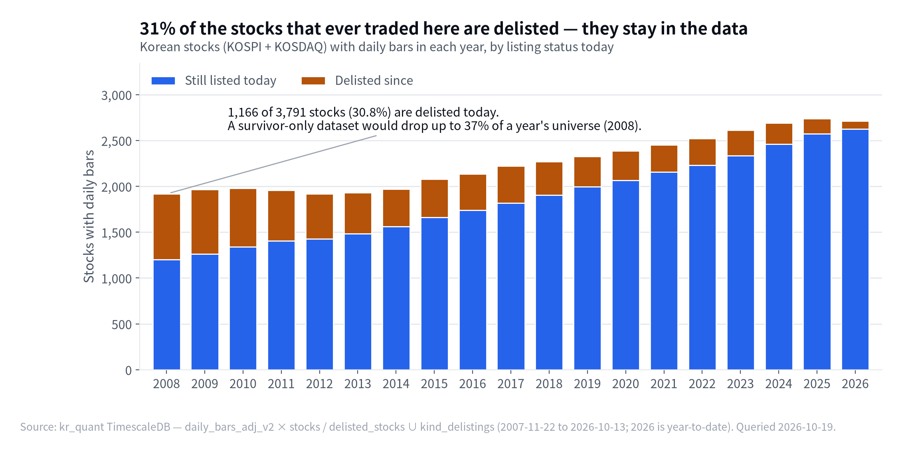
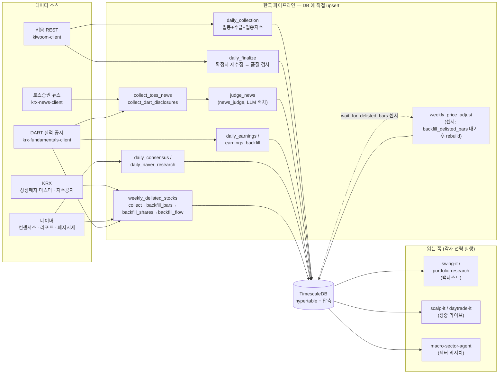
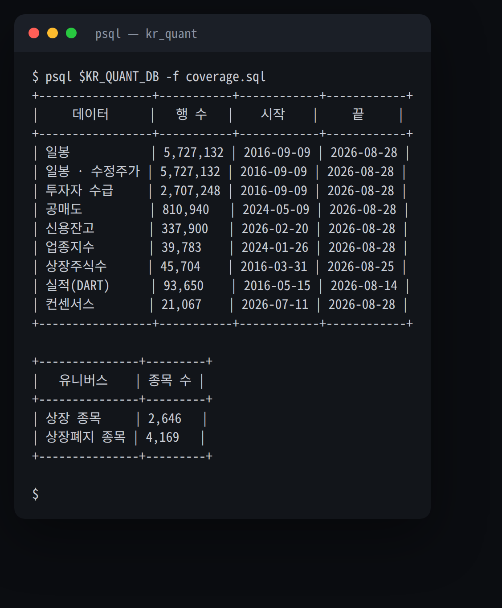

# quant-airflow

**한국 주식 데이터를 TimescaleDB 에 쌓는 Airflow 파이프라인 — 상장폐지 종목까지 되살려 담아, 그 위에서 돌리는 백테스트가 생존편향에 빠지지 않는다.**

[](https://github.com/younghwan91/quant-airflow/actions/workflows/ci.yml)
[](LICENSE)
[](https://www.linkedin.com/in/younghwan-chae/)

<picture>
  <source media="(prefers-color-scheme: dark)" srcset="docs/images/hero-dark.png">
  
</picture>

- **거래된 적 있는 종목의 31% 가 이미 상장폐지됐다.** 지금 상장된 종목만 수집하면 2008년 유니버스의 37% 가 사라진다. 여기서는 KRX 폐지 마스터 → 네이버 과거 일봉 → DART 상장주식수 순으로 되살려 넣는다. (출처: `daily_bars_adj_v2` × `stocks` / `delisted_stocks` ∪ `kind_delistings`, [`docs/images/hero-data.csv`](docs/images/hero-data.csv))
- **16:00 에 받는 그날 값은 잠정치다.** 다음 날 새벽 `daily_finalize` 가 전 거래일 일봉·수급을 확정치로 다시 받아 덮고, 조정주가를 다시 만든다.
- **LLM 뉴스 판정은 테이블에 남길 뿐, 이 레포는 주문을 내지 않는다.** 수집·적재만 한다 — 전략·백테스트·매매는 전부 이 DB 를 읽는 다른 레포의 몫이다.

## Quick start

```bash
git clone <this-repo> quant-airflow
git clone https://github.com/younghwan91/swing-it.git ../swing-it                       # sibling
git clone https://github.com/younghwan91/portfolio-research.git ../portfolio-research  # sibling
cd quant-airflow
cp .env.example .env   # 아래 필수값 채우기 — TIMESCALE_HOST·KR_QUANT_DB 는 예제에 없으니 직접 추가, TIMESCALE_PORT 는 5433 으로

docker compose -f docker-compose.replica.yml up -d   # DB(PRIMARY) — 볼륨은 external 이다
docker compose -f docker-compose.airflow.yml up -d   # Airflow
```

쌓인 데이터는 Postgres 클라이언트면 무엇이든 읽는다.

```python
import pandas as pd, psycopg2
conn = psycopg2.connect(host="<db-host-ip>", port=5433,
                        dbname="kr_quant", user="kr_quant", password="...")
df = pd.read_sql("SELECT * FROM daily_bars_adjusted WHERE code = %s ORDER BY date",
                 conn, params=("005930",))
```

위 DB 줄은 **이미 데이터가 든 볼륨**을 띄우는 것이다. 새 머신에 처음 세울 때는 [설정·운영](#설정운영) 을 본다.

## 무엇을 수집하나

Airflow(LocalExecutor) DAG 21개, 그중 19개가 스케줄로 돈다. 모든 수집기는 `(code, date)` upsert 라 몇 번을 다시 돌려도 안전하고, 행마다 `source`(kiwoom/naver/krx/dart) 를 남긴다.

| 영역 | 소스 | 테이블 | DAG |
|---|---|---|---|
| 일봉·수급·업종지수 | 키움 REST | `daily_bars` · `supply_demand` · `sector_index` | `daily_collection` 평일 16:00 → `daily_finalize` 화~토 06:30 확정 |
| 무수정 일봉 | 키움 REST | `daily_bars_raw` | `daily_bars_raw` 평일 19:00 |
| 조정주가 | (DB 내부 재생성) | `daily_bars_adjusted` | `daily_price_adjust` 평일 16:55 · `weekly_price_adjust` 토 10:40 |
| 공매도·신용잔고 | 키움 REST | `short_selling` · `credit_balance` | `daily_short_credit` 화~토 10:00 |
| 실적 (point-in-time) | DART | `earnings` | `daily_earnings` 평일 16:00 · `earnings_backfill` 일 10:00 |
| 상장주식수 (point-in-time) | 키움 · DART | `shares_outstanding_history` | `weekly_listed_shares` 화 10:10 · `monthly_listed_shares_backfill` 매월 1일 |
| 상장폐지 종목 복원 | KRX · 네이버 · DART | `delisted_stocks` · `daily_bars`(`source='naver'`) | `weekly_delisted_stocks` 토 10:05 |
| 컨센서스 · 증권사 리포트 | 네이버 | `consensus` · `naver_research_reports` | `daily_consensus` 평일 17:00 · `daily_naver_research` 매일 05:40 |
| 뉴스·공시 + LLM 판정 | 토스증권 · DART | `news_articles` · `news_company_feed` · `news_judgments` | `premarket_news_judgment` 평일 08:45 · `daily_news` 10:05/16:05 · `daily_toss_company_news` 17:10 |
| 지수 편입·제외 공지 | KRX | `index_notices` · `index_changes` · `index_constituents` | `daily_index_notices` 평일 18:30 |
| 히스토리 깊이 유지 | 키움 | 업종지수 · 공매도 · 신용 | `weekly_history_backfill` 일 11:00 |
| 전날 실패분 재수집 | 키움 | — | `daily_collection_catchup` 평일 10:05 |

꺼진 DAG 둘: `daily_sharadar`(미국, 아래 참고)·`daily_krx_shares`(KRX 소스가 로그인 벽으로 막혀 수동 전용). 시각은 모두 KST. 소스 호출·파싱은 [kiwoom-client](https://github.com/younghwan91/kiwoom-client)·[krx-fundamentals-client](https://github.com/younghwan91/krx-fundamentals-client)·[krx-news-client](https://github.com/younghwan91/krx-news-client) 에 있고, 이 레포의 `collectors/` 는 조립·적재만 한다.

**미국(Sharadar)은 멈춰 있다.** 2026-09-14 구독 해지 이후 `daily_sharadar` 는 `schedule=None` 이고 DuckDB 스토어는 09-11 빌드에서 멈췄다. 벌크 스냅샷 → 재구축 → 검증 → `os.replace` 공개 설계는 [`docs/sharadar.md`](docs/sharadar.md) 에 그대로 남겨 뒀다.

## 왜 이렇게 만들었나

**생존편향은 수집 단계에서 메운다.** 대부분의 수집기는 "현재 상장된 종목" 목록 위를 돌고, 그 데이터로 만든 백테스트는 살아남은 회사만 보고 성적을 잰다. 여기서는 3층으로 되살린다.

| 층 | 무엇을 | 어디서 |
|---|---|---|
| 마스터 | 상장폐지 종목 목록 | KRX → `delisted_stocks` |
| 시세 | 폐지 전 과거 일봉 | 네이버 → `daily_bars` (`source='naver'`). 2016-09 이전 폐지분은 `daily_bars_delisted_naver`(KIND ∪ KRX 목록, migration 028, 수동 1회) |
| 주식수 | 시총 분모(point-in-time) | DART → `shares_outstanding_history` |

**NULL ≠ 0.** NULL 은 모름, 0 은 없음. 네이버 폐지분은 거래대금이 근사값이고 수급도 기관·외국인만 온다 — 원천이 주지 않는 값은 NULL 로 두고, 원천이 틀린 값은 "고쳐" 넣지 않고 `legacy` 스키마로 뺀다. 읽는 쪽이 이 둘을 구분해야 지표마다 유니버스가 조용히 달라지는 사고를 막는다.

**point-in-time.** `earnings`·`shares_outstanding_history` 는 `knowledge_date` 로 정정 이력을 쌓고 덮어쓰지 않는다. 오늘 값을 과거로 복사하면 과거 시점 백테스트가 미래를 본다.

**잠정치와 확정치를 구분한다.** 장 마감 직후 값은 다음 날 새벽 확정치로 덮이고, `daily_finalize` 뒤에 도는 품질 검사(`collectors/data_checks.py`)가 분봉 세션 범위·종가 항등식·원주가 카나리아를 매일 본다. 2026-09-14 KRX 애프터마켓 개장 뒤 일봉의 고가·저가·종가·거래량이 통합값으로 바뀐 것을 한 달 가까이 몰랐던 것이 이 검사의 이유다.

**"초록불 = 성공" 이 아니다.** 빈 응답을 성공으로 넘긴 수집기가 반복 사고였다. 새 수집기는 빈 응답에 예외를 던지고, 매일 `rows=0` 은 장애로 본다.

**LLM 판정은 배치로, 결과는 테이블로.** 뉴스·공시 판정은 Batch API 로 돌리고 배치 id 를 `news_judge_batches` 원장에 먼저 적는다. 판정은 `news_judgments` 에 쌓일 뿐 — 그걸 어떻게 쓸지는 읽는 레포가 정한다.

## 구조

한국은 소스 API 가 증분만 주므로 DB 에 직접 upsert 한다. 아래는 실제 `dags/*.py` 의 태스크 의존성(`>>`)을 옮긴 것이다.



## 설정·운영

Airflow(스케줄러·웹서버·메타DB)와 TimescaleDB 는 **같은 호스트(simnode)에서 서로 다른 compose 스택으로** 24/7 돈다 — 한쪽을 내리고 올려도 다른 쪽이 안 흔들린다.

| compose 파일 | 내용 |
|---|---|
| `docker-compose.replica.yml` | TimescaleDB **PRIMARY**(:5433). 이름만 replica — `pg_promote()` 로 역할이 바뀌었고 볼륨·포트가 여러 DSN 에 박혀 있어 이름은 안 바꿨다. 역할은 `SELECT pg_is_in_recovery();`(false = PRIMARY) 로 확인 |
| `docker-compose.airflow.yml` | Airflow 4종. DB 는 이 파일에 없다 — `.env` 의 `TIMESCALE_HOST`/`TIMESCALE_PORT` 로 위 PRIMARY 에 붙는다 |
| `docker-compose.timescale.yml` | 초기 DB 세팅(initdb) 참고본 |

`docker-compose.replica.yml` 은 볼륨이 `external` 이고 `POSTGRES_USER/PASSWORD/DB` 가 없어 빈 볼륨에서 initdb 를 하지 못한다. 새 머신에 처음 세울 때는 `docker-compose.timescale.yml`(그 환경변수와 `sql/init_timescale.sql` 마운트가 있다)을 참고하거나 구글 드라이브 백업에서 복원한다. 스키마의 정본은 `sql/init_timescale.sql` + `sql/migrations/*.sql`.

**DB 사본은 하나다** — 리플리카가 없어 두 번째 사본은 구글 드라이브 백업(`scripts/backup_to_gdrive.sh`)뿐이다.

`.env` 에 채워야 하는 값:

| 변수 | 용도 |
|---|---|
| `KIWOOM_APP_KEY` / `KIWOOM_APP_SECRET` | 키움 REST — 시세·수급·공매도·신용·상장주식수 |
| `DART_API_KEY`(`_2`/`_3`) | DART OpenAPI — [무료 발급](https://opendart.fss.or.kr), 보조키를 추가하면 일한도가 키 개수만큼 늘어난다 |
| `ANTHROPIC_API_KEY` | 뉴스·공시 LLM 판정(Batch API) |
| `TIMESCALE_*` / `AIRFLOW_*` | DB 접속 정보·Airflow 시크릿(`.env.example` 에 생성법 주석 포함). **`.env.example` 에 없는 `TIMESCALE_HOST`(호스트 LAN IP)·`KR_QUANT_DB`(DSN) 는 직접 추가하고, `TIMESCALE_PORT` 는 예제의 5432 를 5433 으로 바꾼다** |
| `ALERT_WEBHOOK_URL` | 선택. 비어 있으면 알림은 `alerts.log` 에만 쌓인다 |
| `US_DATA_DIR` | Sharadar DuckDB 스토어 디렉터리. 없으면 `daily_sharadar` 가 돌지 않는다 |

TimescaleDB 는 LAN 에 열려 있어 다른 PC 도 읽기 전용으로 질의한다. 같은 호스트의 다른 레포(scalp-it·daytrade-it 크론)도 이 `.env` 에서 DSN 을 읽는다 — 키 이름을 바꾸거나 지우지 않는다.



*2026-08-28 기준 라이브 DB(그 뒤 `daily_bars_raw` 2007-11-22~ 확장·adj_v2 갱신, 그림은 옛 것). 질의문은 [`docs/coverage.sql`](docs/coverage.sql).*

## 더 자세히

- [`docs/schema.md`](docs/schema.md) — 테이블·PK·단위·압축 설계·마이그레이션
- [`docs/operations.md`](docs/operations.md) — 24/7 단일 호스트, 배포 경로, 알림, 백업
- [`docs/sharadar.md`](docs/sharadar.md) — 미국 파이프라인(중단 상태)

라이선스는 [MIT](LICENSE).

## 기여 및 이슈 제보

- 🐛 버그 제보, 질문, 파이프라인 개선 제안: [GitHub Issues](https://github.com/younghwan91/quant-airflow/issues)
- 📈 업데이트 소식: [팔로우 @younghwan91](https://github.com/younghwan91)


## 관련 프로젝트 — 오픈소스 퀀트 스택

한국·미국 주식과 암호화폐를 아우르는 오픈소스 스택입니다. 각 저장소는 독립적으로 쓸 수 있습니다.

| 축 | 프로젝트 | 설명 |
|---|---|---|
| 🇰🇷 한국 주식 | **[kiwoom-client](https://github.com/younghwan91/kiwoom-client)** | 키움증권 REST API Python 라이브러리 — 국내주식 엔드포인트 전수·실시간 WebSocket, sync + async (`pip install kiwoom-client`) |
| 🇰🇷 한국 주식 | **[krx-fundamentals-client](https://github.com/younghwan91/krx-fundamentals-client)** | 국내 기업 펀더멘탈 Python 클라이언트 라이브러리 — 재무제표·투자지표·배당·종목 스크리닝 (DART + KRX + 네이버) |
| 🇰🇷 한국 주식 | **[krx-news-client](https://github.com/younghwan91/krx-news-client)** | 한국 주식 뉴스·공시를 한 스키마로 내주는 Python 클라이언트 라이브러리 (DART + 토스증권) |
| 🇰🇷 한국 주식 | **[krx-quant-core](https://github.com/younghwan91/krx-quant-core)** | 한국 주식 퀀트 시스템 공통 Python 코어 — KRX 호가·가격제한폭·세션 규칙, 시행일별 거래세 비용모델, 키움 주문 가드, DART 중대공시 위험 분류, 체결 시뮬레이션, Deflated Sharpe·purged CV 통계 |
| 🇰🇷 한국 주식 | **[fin-checkup](https://github.com/younghwan91/fin-checkup)** | 관심종목 위험 공시 텔레그램 알림 + DART·SEC 재무 건강검진 — 측정값과 사실만 전달한다 |
| 🇰🇷 한국 주식 | **[swing-it](https://github.com/younghwan91/swing-it)** | 코스피·코스닥 알파 심사 프레임워크 — 개별 트레이드 분포로 판정하고 랜덤 음성대조·purged CV·Deflated Sharpe 를 CI 가드레일로 강제 |
| 🇺🇸 미국 주식 | **[portfolio-research](https://github.com/younghwan91/portfolio-research)** | 미국주식 팩터 엔진 — point-in-time·생존편향 보정 데이터 위에서 walk-forward 를 Deflated Sharpe·PBO 로 게이팅하고 ETF 전술배분도 같은 관문을 지난다 |
| 🇺🇸 미국 주식 | **[macro-sector-agent](https://github.com/younghwan91/macro-sector-agent)** | 하향식 미국 산업 사이클 리서치 — \"어느 산업이 잊혔나\"를 묻고 기계는 제외만 한다 |
| 🇺🇸 미국 주식 | **[automated-stock-trading-systems](https://github.com/younghwan91/automated-stock-trading-systems)** | Bensdorp 의 7개 비상관 트레이딩 시스템 백테스터 (교육용 재구현) |
| ₿ 암호화폐 | **[binance-quant-engine](https://github.com/younghwan91/binance-quant-engine)** | 암호화폐 선물 백테스트·실행 엔진 — 룩어헤드 0, 백테스트↔실거래 일체화 |
| ₿ 암호화폐 | **[crypto-quant-insights](https://github.com/younghwan91/crypto-quant-insights)** | 실거래 선물 시스템을 검증하며 나온 차트 연구 노트 — 폭락 스트레스 테스트·Kelly 레버리지·체결 간극 |

## 만든 사람

**채영환 (Younghwan Chae)** · [GitHub @younghwan91](https://github.com/younghwan91) · [LinkedIn](https://www.linkedin.com/in/younghwan-chae/)
